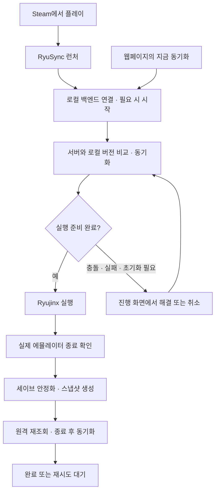
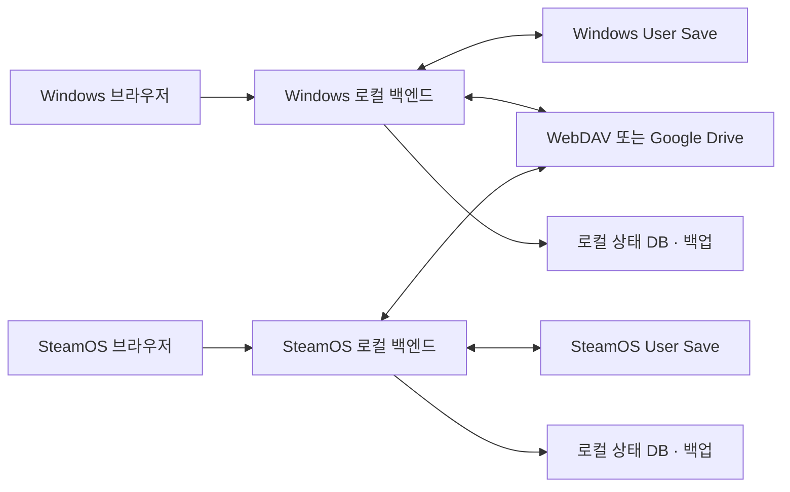

# Ryujinx Save Sync 기획서

- 작성일: 2026-10-20
- 상태: 구현 전 제안
- 대상: Windows 11 x64, SteamOS x64에서 Ryujinx를 사용하는 개인 사용자
- 목표: 두 기기의 User Save를 WebDAV 또는 Google Drive로 동기화하고 웹페이지에서 설정·상태 확인·충돌 해결·복원을 수행한다.

## 1. 권장 방향

**각 기기에 설치하는 .NET 백엔드 + React 웹 프론트엔드 + 원격 저장소 어댑터**로 구성한다. Ryujinx가 사용하는 C# 파일시스템 구성 요소를 활용해 게임별 세이브를 자동 발견하는 것을 MVP 요구사항으로 둔다.

백엔드는 실제 세이브 파일을 읽고 쓰며, 로컬 웹서버에서 프론트엔드도 제공한다. 사용자는 프로그램을 실행한 뒤 브라우저에서 `http://127.0.0.1:17843`에 접속한다. 포트는 제안값이며 충돌 시 다른 포트를 사용한다. 설정을 마친 뒤에는 브라우저를 닫아도 백엔드가 동작한다.

원격 서버에는 세이브 스냅샷과 동기화 메타데이터를 저장한다. 별도의 중앙 애플리케이션 서버는 기본 구성에 필요하지 않다. WebDAV 서버는 사용자가 준비하고, Google Drive 선택 시 Google의 저장소를 사용한다.

첫 구현은 WebDAV로 진행한다. 저장소와 동기화 엔진을 분리하여 다음 단계에 Google Drive를 추가한다. 최종적으로 두 방식을 모두 지원하되, 하나의 동기화 공간에서는 하나의 저장소만 사용한다.

핵심 원칙:

1. 게임 실행 중에는 해당 설치본의 세이브를 업로드하거나 덮어쓰지 않는다.
2. 파일별 최신 수정 시각만으로 승자를 결정하지 않는다.
3. 게임·프로필 단위의 전체 스냅샷을 교환한다.
4. 양쪽에서 변경되면 양쪽 버전을 보존하고 선택을 요청한다.
5. 다운로드 적용 전에 로컬 백업을 만들고 실패 시 복구한다.
6. 설치본·게임 업데이트 버전 간 세이브 호환성은 별도 확인한다.

## 2. 사용자 시나리오

### 최초 설정

1. Windows에서 프로그램을 실행하고 웹 설정 화면을 연다.
2. WebDAV 주소·계정 또는 Google Drive 계정을 연결한다.
3. 새 동기화 공간을 생성하고 기기 이름을 지정한다.
4. 프로그램이 설치본의 데이터 폴더와 세이브 인덱스를 읽어 게임 이름·Title ID·프로필·세이브 경로를 목록에 표시한다.
5. 동기화할 게임을 선택한다. 여러 프로필이 있거나 상대 기기의 프로필이 모호하면 한 번만 짝을 확인한다.
6. 최초 원본으로 사용할 세이브를 선택하고 원격 스냅샷을 생성한다.
7. SteamOS에서 같은 원격 공간을 연결한다.
8. SteamOS에서도 설치본과 세이브를 자동 발견한다. 동일 Title ID의 게임을 연결하고 프로필 짝을 확인한다. 대상 기기에 해당 게임의 세이브가 아직 없으면 Ryujinx에서 한 번 실행해 저장소 인덱스를 생성하도록 안내한다.
9. 내려받을 내용과 기존 로컬 세이브의 백업 계획을 확인한 후 최초 동기화를 수행한다.

기존 세이브가 양쪽에 있으면 최초 연결 시 자동으로 한쪽을 덮어쓰지 않는다. 내용이 같으면 연결하고, 다르면 원본 선택 또는 충돌 보존 절차를 따른다.

### 평상시 사용

- Windows에서 게임 종료 → 파일 안정화 확인 → 스냅샷 업로드.
- SteamOS에서 플레이 전 동기화 → 로컬 백업 → 검증된 스냅샷 적용.
- SteamOS에서 게임 종료 → 업로드 → 다음 Windows 플레이 전 내려받기.
- 오프라인 플레이 → 로컬 변경 보존 → 연결 회복 시 원격과 비교.
- 두 기기에서 따로 플레이 → 충돌 표시 → 원하는 진행 상황 선택.

Steam 비 Steam 게임의 실행 대상을 RyuSync 런처로 설정한다. 런처가 백엔드에 실행 전 동기화를 요청하고, 완료된 뒤 Ryujinx를 실행하며, 종료 후 동기화를 요청한다. 이 실행 흐름과 웹페이지의 수동 동기화는 MVP 필수 기능이다. 사용자가 런처를 거치지 않고 Ryujinx를 직접 실행한 경우에는 실행 전 동기화를 보장할 수 없다.

### Steam 실행 전·후 동기화



**실행 전:** 서버를 조회하고 마지막 공통 revision을 기준으로 비교한다. 서버만 바뀌었으면 백업 후 내려받고, 로컬만 바뀌었으면 미전송 변경을 먼저 업로드한다. 양쪽이 바뀌었으면 충돌을 해결할 때까지 실행을 보류한다. 매번 서버 파일로 로컬을 덮어쓰는 방식은 사용하지 않는다.

**실행 중:** 해당 설치본에 실행 예약을 유지한다. 웹페이지·주기 작업은 원격 상태를 조회할 수 있지만 로컬 세이브의 스냅샷 생성과 교체는 보류한다. 로컬 실행 예약은 다른 기기의 플레이를 차단하는 전역 잠금이 아니므로 원격 충돌 검사는 계속 필요하다.

**실행 후:** 실제 Ryujinx 프로세스가 끝나고 파일 변경이 안정된 뒤 스냅샷을 만든다. 원격을 다시 조회하여 변경된 로컬 세이브를 게시한다. 그 사이 다른 기기에서도 변경되었다면 두 가지 이력을 보존하고 충돌로 표시한다. 게임에서 타이틀 화면으로 돌아온 것을 프로세스 종료로 취급하지 않는다.

### Steam 등록 방식과 동기화 범위

Steam은 비 Steam 게임의 바로가기 등록을 지원한다. 이 프로그램에서는 그 바로가기 대상으로 RyuSync 런처를 지정하는 구성을 제공한다. 실제 Steam Cloud 동기화와는 별개의 자체 동기화다. [자료 9](https://help.steampowered.com/en/faqs/view/4B8B-9697-2338-40EC)

- **Ryujinx 하나를 등록:** 사용자가 요청한 기본 방식. 시작 전에 선택된 게임·프로필 전체를 동기화한다. Ryujinx 안에서 여러 게임을 플레이할 수 있으므로, Ryujinx 자체를 종료한 뒤 전체를 재스캔하여 변경된 항목만 동기화한다.
- **게임별 바로가기:** 선택 기능. 로컬에 저장한 실행 프로필을 통해 게임 경로·사용자·Ryujinx 인수를 연결하고 해당 게임의 세이브를 우선 동기화한다. 실제 게임 인수와 자동 종료 동작은 빌드별로 검증한다.
- 웹 UI에서 실행 파일, 작업 디렉터리, 데이터 루트, 선택적 게임 인수를 설정하고 Steam의 대상·시작 위치·실행 옵션에 넣을 값을 표시한다. MVP는 Steam의 바로가기 DB를 직접 수정하지 않는다.
- 런처 인수는 `launch --launch-profile <id>` 형태로 설계한다. 비밀번호·토큰은 실행 옵션에 넣지 않는다. 경로와 인수는 셸 문자열 조합 대신 구조화한 프로세스 인수로 전달한다.
- Linux 네이티브 런처와 Windows 실행 파일을 각각 제공한다. SteamOS의 실제 실행 환경, 입력·포커스, 프로세스 생존 여부는 실기 검증한다.

### 실패·오프라인·초기 세이브 처리

| 상황 | 실행 동작과 데이터 처리 |
|---|---|
| 실행 전 동기화 정상 완료 | 게임 실행 |
| 충돌 발견 | 실행 보류, 버전 선택 또는 취소 |
| 서버 연결 실패·인증 만료 | 재시도·취소 제공. 유효한 로컬 세이브가 있으면 명시적으로 오프라인 실행 선택 가능 |
| 서버에만 세이브 존재 | 초기화 필요 표시. 사용자가 초기화 실행을 선택하면 로컬 저장소 생성 후 종료하도록 안내 |
| 초기화 실행 종료 | 서버 원본 선택 상태를 유지하여 새 빈 세이브의 자동 업로드를 차단. 로컬 백업 후 서버 버전 적용 |
| 종료 후 업로드 실패 | 검증된 로컬 스냅샷과 작업을 DB에 보관하고 연결 복구 후 재시도 |
| 강제 종료·절전·전원 종료 | 즉시 업로드를 보장하지 않음. 다음 백엔드 시작·복귀 때 실행 상태와 미완료 작업을 확인 |

초기화 실행 중에도 플레이한 흔적이 있는 로컬 세이브가 생겼다면 진행 상황을 자동 폐기하지 않고 선택을 요청한다. 초기화 대기 중 서버 버전이 바뀌면 다시 비교한다. 서버에만 세이브가 있고 오프라인이면 내려받기를 완료할 수 없다는 상태를 명시한다.

Gaming Mode에서는 진행·실패·충돌을 런처 화면에서 확인할 수 있어야 한다. 웹 UI의 진행 화면을 컨트롤러로 조작 가능한 로컬 창에 표시하는 방식을 우선 검증한다. 별도 브라우저를 수동으로 찾아 열어야만 실행을 계속할 수 있는 흐름은 MVP 완료로 보지 않는다.

### 웹페이지 수동 동기화와 작업 조정

웹페이지에 `전체 동기화`와 게임별 `지금 동기화`를 제공한다. 양방향 비교·백업·충돌 정책은 Steam 런처와 동일하다. 업로드·다운로드를 강제로 선택하는 기능은 일반 동기화와 분리된 충돌 해결·복원 절차에서만 제공한다.

런처와 프론트엔드는 동일한 백엔드 작업 큐를 사용한다. 요청에 작업 출처(`steam-pre`, `steam-post`, `web`, `retry`)와 대상 세이브를 기록한다. 같은 대상의 중복 요청은 기존 작업에 연결하고 상태를 공유한다. 실행 전 동기화 완료부터 프로세스 시작까지 설치본 단위 실행 예약을 유지하여 그 사이 웹 동기화가 개입하지 못하게 한다.

게임 실행 중 웹에서 동기화를 요청하면 `게임 종료 후 실행 대기`로 표시하고 종료 후 작업과 합친다. 게임이 종료된 후에도 앱이나 Steam이 종료 후 작업을 강제로 끊을 수 있으므로 작업 상태를 백엔드 DB에 영속화한다. 별도 백엔드 프로세스가 항상 살아남는다고 가정하지 않는다.

## 3. 범위

| 기능 | WebDAV MVP | 후속 단계 |
|---|---|---|
| Windows 11·SteamOS 실행 | 포함 | 배포 편의 개선 |
| 로컬 웹 설정 UI | 포함 | Gaming Mode 접근 편의 |
| 게임 이름·Title ID·프로필·세이브 경로 자동 발견 | 포함 | 설치본별 호환 범위 확대 |
| 자동 판별 불가 항목의 수동 보정 | 포함 | 보정 필요 사례 축소 |
| WebDAV 연결·검증 | 포함 | 서버별 호환성 확대 |
| Google Drive | 인터페이스만 준비 | OAuth 및 동기화 구현 |
| 웹페이지 전체·게임별 수동 동기화 | 포함 | 유지 |
| 게임 종료 후 자동 업로드·주기적 조회 | 포함 | 절전 복귀 대응 개선 |
| 충돌 보존·선택 | 포함 | 상세 비교 보조 |
| 로컬 백업·복원·작업 이력 | 포함 | 저장 용량 관리 |
| Steam 비 Steam 등록용 실행 전·후 동기화 런처 | 포함 | 게임별 바로가기 편의 개선 |
| Gaming Mode 진행·오류·오프라인 실행 선택 | 포함 | 입력·화면 품질 개선 |
| 다른 기기에서 웹 관리 | 제외 | 필요 시 인증 포함 설계 |

기본 제외 대상은 게임 ROM, 펌웨어, 키, 셰이더 캐시, 모드, Ryujinx 전체 설정, 전체 NAND, Device Save다. User Save 내부의 파일을 의미 없이 선별하지 않고 등록된 세이브 내용 전체를 하나의 단위로 취급한다.

바이너리 세이브의 내용 병합, 서로 다른 에뮬레이터 간 변환, 동시에 두 기기에서 플레이하면서 실시간으로 진행 상황을 합치는 기능은 제공하지 않는다.

## 4. 세이브 경로와 기기 간 연결

Windows의 일반 설치 경로 후보는 `%APPDATA%\Ryujinx\bis\user\save`, 포터블 설치는 해당 설치본의 `portable\bis\user\save`다. 프로젝트 계열 문서는 게임 메뉴의 `Open User Save Directory`로 실제 경로를 확인하도록 안내한다. [자료 1](https://github.com/Ryubing/docs/blob/main/docs/info/faq-%26-troubleshooting.md)

Linux는 `~/.config/Ryujinx/bis/user/save`를 **탐색 후보**로 둔다. SteamOS의 실제 경로는 설치 방식, 포터블 설정, EmuDeck 구성, 외장 저장소 등에 따라 달라질 수 있으므로 설치본의 데이터 루트와 내부 인덱스를 읽어 결정한다. 자동 발견에 실패했을 때만 사용자가 데이터 루트를 지정한다.

### 자동 발견 절차

1. Windows의 기본 데이터 위치·포터블 설치본, SteamOS의 기본 사용자 설정 위치·EmuDeck 후보를 탐색한다. 이미 열린 설치본의 프로세스 경로와 명령행에 커스텀 데이터 루트가 나타나면 후보에 포함한다. 여러 설치본이 발견되면 사용자가 동기화할 설치본을 고른다.
2. 선택한 설치본의 `games/<Title ID>/gui/metadata.json`에서 게임 이름을 읽는다. 메타데이터가 없는 게임도 세이브 인덱스의 Title ID로 목록에 표시한다. 폴더 이름만으로 세이브 폴더를 추측하지 않는다. 확인한 Ryujinx 계열 코드가 게임 메타데이터에 제목을 기록한다. [자료 6](https://git.h3cjp.net/H3cJP/ryujinx/src/commit/69c22a744e14b2dcc5e2e1ee6f85d305a56a9403/src/Ryujinx/Systems/AppLibrary/ApplicationLibrary.cs)
3. Ryujinx의 세이브 인덱스를 **읽기 전용**으로 열어 `SaveDataId`, `ProgramId`(Title ID), `UserId`, 세이브 타입을 열거한다. Ryujinx의 세이브 관리자는 이 정보를 사용해 게임과 세이브를 연결한다. [자료 7](https://git.axenov.dev/Museum/ryujinx/commit/d9053bbe3745846dd758561e24dd060d76b3ad9d?files=Ryujinx.Ava%2FCommon)
4. User Save 타입만 대상으로 하고, 인덱스의 `SaveDataId`와 해당 설치본의 NAND 루트로 `bis/user/save/<SaveDataId:16자리 hex>`를 찾는다. `0` 또는 `1` 중 Ryujinx가 다음 로드에 사용할 쪽을 해당 빌드에서 확인해 사용한다. 확인한 메뉴 구현은 커밋 디렉터리 `0`을 우선하고, 없으면 작업 디렉터리 `1`을 연다. 단순히 두 디렉터리를 합치지 않는다. [자료 8](https://git.axenov.dev/Museum/ryujinx/src/commit/d6d3cdd5739e6b8f8df36bf393e440f4857fb2b7/src/Ryujinx.Ava/Common/ApplicationHelper.cs)
5. 계정 정보에서 사용자 표시 이름을 읽고, `Title ID + 사용자 ID + 세이브 타입`을 기기 내부의 발견 키로 사용한다. 화면에는 게임 이름·프로필 이름·경로·발견 출처를 보여준다. 이름이 없으면 Title ID/사용자 ID를 표시한다.
6. 설치본을 바꾸거나 Ryujinx가 새 세이브를 만들면 재스캔한다. 기존 연결의 `SaveDataId`가 바뀌면 새 경로와 콘텐츠를 검증하고, 자동으로 덮어쓰기 전에 이력과 비교한다.

세이브 폴더 이름은 게임 Title ID가 아니라 내부 `SaveDataId`이므로 폴더 순회나 이름 유사도로 게임을 자동 배정하지 않는다. 지원하지 않는 포크·손상된 인덱스·중복 발견은 `확인 필요`로 표시한다. 사용자는 그 항목만 Ryujinx의 `Open User Save Directory`로 검증하여 보정한다.

두 기기의 **Title ID**가 같으면 게임 후보를 자동 연결할 수 있다. 두 기기의 Ryujinx **사용자 ID**가 다르면 프로필이 하나씩인 경우 같은 사람인지 한 번 확인해 연결한다. 여러 프로필은 표시 이름이 같아도 자동 결론을 내리지 않고 대응 관계를 확인받는다. 이 확인은 게임마다 반복하지 않는다.

세이브 디렉터리의 숫자 이름이나 에뮬레이터 내부 사용자 ID가 두 기기에서 같다고 가정하지 않는다. 아래처럼 원격의 논리 식별자와 기기별 경로를 분리한다.

| 항목 | 예시 | 의미 |
|---|---|---|
| `workspace_id` | 무작위 UUID | 원격 동기화 공간 |
| `save_set_id` | 무작위 UUID | 게임·프로필 조합의 동기화 단위 |
| `game_title_id` | 인덱스에서 읽은 Title ID | 게임 자동 연결 키 |
| `profile_label` | 메인 사용자 | 사용자에게 보이는 이름 |
| `local_user_id` | 설치본의 사용자 ID | 기기 내부 계정 식별 |
| `local_save_data_id` | 설치본의 SaveDataId | 기기 내부 세이브 디렉터리 식별 |
| `device_id` | 설치 시 생성한 UUID | 현재 기기 식별 |
| `local_path` | 기기별 실제 User Save 경로 | 해당 기기에서만 저장 |

MVP에서는 대상 기기의 Ryujinx가 게임·프로필과 저장 위치를 먼저 생성하도록 한다. 내부 저장소 인덱스나 계정 DB를 직접 수정하지 않고 실제 세이브 내용만 교체한다. 세이브가 아직 없는 대상 기기에서 인덱스를 안전하게 생성하는 방법은 0단계에서 조사한다. 안전한 방법이 확인되지 않으면 게임을 한 번 실행해 로컬 세이브를 만들도록 안내한다. 세이브를 생성할 수 없는 게임은 초기 지원 대상에서 제외하거나 별도 검증한다.

구현 전 검증 항목:

- 두 OS에서 동일 게임·동일 업데이트 버전으로 세이브 이동 후 정상 로드되는지 확인한다.
- 사용할 빌드에서 읽기 전용 인덱스 열거로 Title ID·사용자 ID·SaveDataId와 디렉터리가 실제로 일치하는지 확인한다.
- `0`/`1` 커밋·작업 디렉터리 전환 시 무엇을 백업하고 적용해야 하는지 확인한다.
- 다중 프로필에서 선택한 디렉터리의 경계와 필요한 파일을 확인한다.
- 지원할 Ryujinx 빌드·포크·설치 방식을 기록한다.
- 빈 디렉터리가 신규 상태인지, 경로 오류인지, 삭제 상태인지 구분한다.
- 심볼릭 링크는 등록 시 실제 경로를 확인하되, 스냅샷 내부 링크는 기본 거부한다.

## 5. 전체 구성



프론트엔드와 백엔드는 소스와 역할을 분리하지만, 배포 시 빌드된 프론트엔드를 백엔드 실행 파일에 포함한다. 사용자는 Node.js나 별도 웹서버를 설치할 필요가 없도록 한다.

웹페이지는 각 기기의 로컬 백엔드를 조작한다. WebDAV 서버에 웹페이지만 올리는 방식으로는 두 기기의 저장 파일에 지속적으로 접근할 수 없으므로 설치형 에이전트가 필요하다.

### 기술 선택

| 영역 | 제안 | 이유 |
|---|---|---|
| 백엔드 | C#/.NET, ASP.NET Core | Ryujinx의 C# 세이브 인덱스 읽기 코드를 재사용할 수 있는지 검증하기 쉬움 |
| 프론트엔드 | React + TypeScript + Vite | 설정 폼·상태·충돌 UI 구성 |
| 로컬 DB | SQLite | 작업 이력·기준 revision·복구 저널의 트랜잭션 관리 |
| 스냅샷 | ZIP + JSON manifest + SHA-256 | 구현 단순화와 무결성 검증 |
| 상태 전달 | REST + SSE | 명령 요청과 작업 진행 상태 분리 |
| 자격 증명 | Windows Credential Manager / Linux Secret Service | 비밀번호·토큰을 일반 설정 파일과 분리 |

세이브 발견 어댑터가 해당 Ryujinx 빌드의 LibHac API와 인덱스를 **읽기만** 할 수 있는지 0단계에서 먼저 실증한다. 가능하면 .NET 백엔드에 어댑터로 넣고, 실패하면 해당 빌드에 맞는 인덱스 리더를 구현하되 무근거한 폴더 추측으로 대체하지 않는다. 라이브러리 버전과 SQLite 드라이버는 구현 착수 시 유지보수 상태·라이선스·양 OS 빌드를 확인하여 고정한다. SteamOS에서 Secret Service가 제공되지 않거나 Gaming Mode에서 잠겨 있는 경우를 검증한다. 대안은 사용자가 입력하는 암호로 보호한 저장소이며, 잠금 해제 전에는 자동 동기화를 중지한다. 복호화 키를 암호문 옆에 저장하는 방식은 사용하지 않는다.

## 6. 백엔드 모듈

- **설정 관리:** 기기 이름, 설치본, 저장소, 게임 경로, 동기화 정책.
- **Ryujinx 발견 어댑터:** 설치본·게임 메타데이터·계정·세이브 인덱스를 읽고 자동 연결 후보 생성.
- **경로 검증:** 발견한 경로의 존재, 권한, 중복·상하위 경로 충돌, 이동식 디스크 상태 확인.
- **실행 상태 감지:** 프로세스 경로·명령행·실행 래퍼 정보로 설치본 실행 여부 판단.
- **실행 관리자:** 시작 전 동기화, 설치본 실행 예약, 자식·분리된 실제 에뮬레이터 프로세스 추적, 종료 후 작업 예약.
- **변경 감지:** 파일시스템 이벤트로 후보 생성, 정기 스캔과 해시로 실제 변경 확인.
- **스냅샷 생성:** 실행 종료와 안정화 확인 후 임시 위치에 복사·검증·압축.
- **동기화 엔진:** 기준 revision 비교, 업로드, 다운로드, 충돌 판단.
- **저장소 어댑터:** 목록 조회, 읽기, 고유 객체 쓰기, 무결성 검증.
- **복원 관리자:** 백업, 적용 저널, 실패 복구, 이전 버전 복원.
- **작업 관리자:** 중복 실행 방지, 취소, 재시도, 진행률·로그 제공.

프로세스 감지가 불확실하면 자동 적용을 보류한다. 파일 변경이 몇 초 없었다는 사실만으로 게임이 종료되었다고 판단하지 않는다.

## 7. 동기화 데이터 모델과 충돌 처리

### 스냅샷 단위

게임·프로필별 디렉터리 전체를 하나의 스냅샷으로 저장한다. 여러 파일로 구성된 세이브가 서로 다른 시점의 파일로 섞이지 않도록 한다.

Manifest 필드:

```json
{
  "schema_version": 1,
  "workspace_id": "<uuid>",
  "save_set_id": "<uuid>",
  "revision_id": "<uuid>",
  "parent_revision_ids": ["<previous-revision>"],
  "device_id": "<uuid>",
  "created_at": "<UTC timestamp>",
  "content_hash": "<canonical-tree-sha256>",
  "archive_hash": "<archive-sha256>",
  "files": [
    {"path": "relative/path", "size": 1234, "sha256": "<sha256>"}
  ]
}
```

파일 경로는 `/` 구분자로 정규화하고 정렬한 뒤 경로·크기·내용 해시로 트리 해시를 계산한다. 빈 디렉터리도 별도 목록으로 보존한다. 수정 시각은 표시·스캔 최적화에만 사용하며, 변경 판단의 최종 근거로 삼지 않는다.

### 기준 상태 비교

기기별로 마지막에 적용하거나 게시한 revision과 그 내용 해시를 보관한다.

| 로컬 상태 | 원격 상태 | 처리 |
|---|---|---|
| 기준과 동일 | 기준과 동일 | 작업 없음 |
| 로컬만 변경 | 기준과 동일 | 새 revision 업로드 |
| 기준과 동일 | 기준의 후속 revision 존재 | 백업 후 다운로드 적용 |
| 양쪽 변경 | 결과 내용 동일 | 공통 상태로 정리 |
| 양쪽 변경 | 결과 내용 다름 | 충돌 보존·사용자 선택 |
| 기준 없음 | 원격과 로컬 모두 존재 | 최초 연결 절차 |
| 경로 접근 불가 | 무관 | 오류로 중지, 삭제로 해석하지 않음 |

### 동시 업로드

원격의 하나뿐인 `latest.zip`을 덮어쓰는 구조는 사용하지 않는다. 각 업로드는 고유 revision과 부모 revision을 가지며, 같은 부모에서 두 업로드가 발생하면 두 가지 이력이 남는다.

원격 이력에서 자식이 없는 revision이 여러 개면 충돌로 판단한다. 한 기기가 먼저 업로드 성공을 표시했더라도 이후 다른 가지가 발견되면 충돌 상태로 전환한다. 이 방식은 동시 쓰기 자체를 막지는 않지만, 다른 기기의 데이터를 조용히 소실시키지 않는다.

충돌 해결 시 양쪽을 백업한 후 선택한 내용으로 새 revision을 만들고, 해결한 모든 가지를 부모로 기록한다. 세이브 내용을 바이너리 단위로 합치지 않는다. 원격 목록은 페이지 끝까지 조회하고, 일시적으로 목록이 덜 보이는 상황은 재조회로 확인한다.

### 게시 순서와 원격 구조

```text
save-sync/<workspace-id>/
  workspace.json
  saves/<save-set-id>/
    objects/<revision-id>.zip
    commits/<revision-id>.json
```

1. 안정적인 로컬 복사본을 생성한다.
2. 아카이브를 고유 객체로 업로드한다.
3. 업로드된 객체의 크기·해시를 검증한다.
4. Manifest를 commit 객체로 게시한다.
5. 상대 기기는 완전한 Manifest와 해시가 맞는 아카이브만 적용한다.

중단된 업로드, 파싱 불가능한 Manifest, 아직 내려받을 수 없는 아카이브는 정상 revision으로 적용하지 않는다. 커밋 전 객체는 고아 객체로 남겨 복구·정리 대상으로 분류한다.

Google Drive에서는 위 구조를 논리 모델로 사용하고 실제 접근은 file ID로 수행한다. 이름의 유일성을 가정하지 않는다. 같은 revision ID의 중복 객체는 내용이 같을 때만 같은 것으로 취급하고, 내용이 다르면 무결성 오류로 중지한다.

## 8. 안전한 로컬 적용

1. 현재 게임 실행 여부와 경로 접근 권한을 확인한다.
2. 저장 위치와 같은 파일시스템의 임시 디렉터리에 다운로드·압축 해제한다.
3. 절대 경로, `..`, 링크, Windows 예약 이름, 대소문자 충돌, 압축 폭탄을 검사한다.
4. 파일 목록·크기·해시를 Manifest와 비교한다.
5. 현재 세이브를 별도 백업하고 적용 전 상태를 저널에 기록한다.
6. 로컬 내용이 계획 수립 이후 바뀌지 않았는지와 실행 상태를 다시 확인한다.
7. 기존 디렉터리를 백업 이름으로 이동하고 새 디렉터리를 원래 위치로 이동한다.
8. 성공 검증 후 기준 revision을 갱신한다.

두 번의 디렉터리 이동 전체가 모든 OS에서 원자적이라고 가정하지 않는다. 단계별 저널과 재시작 시 복구로 중간 실패를 처리한다. Windows의 열린 파일이나 다른 프로그램의 잠금으로 실패하면 기존 세이브를 복구하고 재시도 가능한 오류로 표시한다.

외부에서 게임을 직접 실행하면 최종 확인과 교체 사이의 경쟁 조건을 완전히 없애기 어렵다. MVP의 Steam 런처 실행은 실행 예약으로 해당 구간을 통제한다. 런처 밖에서 실행된 프로세스를 감지하면 로컬 적용을 중단한다.

복원도 과거 내용을 새 revision으로 게시하는 방식이다. 과거 revision으로 기준 포인터만 되돌려 다른 기기 변경을 지우지 않는다.

삭제 정책:

- 게임 등록 해제는 동기화만 끄며 로컬·원격 파일을 지우지 않는다.
- 로컬 경로가 사라지거나 SD 카드가 분리되면 오류로 처리한다.
- 정상 스냅샷 내부의 파일 삭제는 백업 후 스냅샷 교체에 반영한다.
- 디렉터리 전체가 비었을 때는 삭제 의도 확인 전 업로드를 보류한다.
- MVP는 원격 이력 자동 삭제를 하지 않고 용량을 표시한다.
- 후속 정리 기능은 충돌·복구 대상과 이력 연결을 보존하는 규칙부터 설계한다.

## 9. 저장소별 설계

### WebDAV

입력값은 서버 URL, 전용 하위 경로, 사용자 이름, 비밀번호 또는 앱 비밀번호다. HTTPS를 기본으로 하고 자체 인증서는 별도 신뢰 인증서 등록으로 처리한다.

초기 연결 테스트는 전용 테스트 경로에서 디렉터리 생성, 업로드, 목록 조회, 다운로드, 내용 검증, 테스트 파일 삭제까지 수행한다. 실제 세이브 파일은 연결 테스트에 사용하지 않는다.

WebDAV의 `PROPFIND`, `MKCOL`, `GET`, `PUT`, `DELETE`를 기본 기능으로 사용한다. 서버의 LOCK 지원을 필수로 만들지 않고, 동시 게시 안전성은 불변 revision으로 확보한다. RFC에 정의된 기능이라도 실제 서버의 권한·프록시·업로드 크기 제한은 별도로 검증한다. [자료 2](https://www.rfc-editor.org/rfc/rfc4918)

Nextcloud와 사용자가 실제 사용하는 NAS/WebDAV 서버를 우선 검증 대상으로 삼는다. 검증 전에는 모든 WebDAV 서버 호환을 약속하지 않는다.

### Google Drive

기본 저장 위치는 앱 전용 `appDataFolder`, 권한은 `drive.appdata`로 제안한다. 일반 Drive 폴더처럼 사용자가 파일을 직접 관리하는 방식과 다르므로 웹 UI에서 내보내기를 제공한다. 두 기기는 같은 Google 계정과 같은 앱의 OAuth 구성을 사용하도록 한다. [자료 3](https://developers.google.com/workspace/drive/api/guides/appdata)

Desktop OAuth 클라이언트, 시스템 브라우저, PKCE와 state 검증, 루프백 콜백을 사용한다. 토큰은 백엔드에서 관리한다. 배포 실행 파일에 들어가는 OAuth client secret을 비밀 보호 수단으로 간주하지 않는다. [자료 4](https://developers.google.com/identity/protocols/oauth2/native-app)

개인 개발판은 사용자가 만든 OAuth 프로젝트로 시작할 수 있다. 배포판은 프로젝트 소유자, 동의 화면, 게시 상태와 요구되는 심사 조건을 출시 전에 확정한다. 개발·테스트 설정의 토큰 수명을 장기 운영의 전제로 삼지 않는다.

Drive 어댑터는 file ID, 페이지네이션, 업로드 재시도, 만료 토큰 재인증, API 제한에 대한 지수 백오프를 처리한다. 대용량 스냅샷에는 재개 가능한 업로드 도입을 검토한다.

### 비교

| 기준 | WebDAV | Google Drive |
|---|---|---|
| 사용자 준비 | 접근 가능한 서버·계정 필요 | Google 계정·앱 OAuth 구성 필요 |
| 개발 부담 | 서버별 동작 차이 검증 | OAuth·토큰·API 제한 처리 |
| 데이터 관리 | 서버 폴더와 백업 정책 직접 관리 | 앱 전용 공간, 앱에서 내보내기 제공 |
| 권장 순서 | MVP | 두 번째 저장소 |

## 10. 웹 화면과 API

화면은 한국어를 기본으로 하며 Steam Deck 화면에서도 주요 버튼을 누르기 쉽게 만든다.

| 화면 | 주요 내용 |
|---|---|
| 초기 설정 | 기기 이름 → 저장소 연결 → 공간 선택 → 설치본 자동 발견 → 게임 선택 → 최초 원본 선택 |
| 대시보드 | 저장소 연결, 전체·게임별 지금 동기화, 실행 전 준비·플레이 중·종료 후 전송·재시도 대기 상태 |
| Steam 실행 설정 | 실행 파일·데이터 루트·동기화 범위, Steam 등록 값, 오프라인 정책 |
| 게임·프로필 | 자동 발견한 제목·Title ID·프로필·로컬 경로, 발견 출처, 확인 필요 항목, 자동 동기화 여부, 실행 상태 |
| 저장소 설정 | 연결 테스트, 재인증, 사용 공간, 연결 변경 |
| 충돌 해결 | 기기·시간·용량·revision 비교, 두 버전 보존, 사용할 버전 선택 |
| 이력·복원 | 성공·실패 원인, 백업 목록, 복원 미리보기 |
| 일반 설정 | 시작 시 실행, 조회 간격, 백업 한도, 로그 내보내기 |

파일 내용으로 실제 플레이 진행도를 해석하지 않으므로 충돌 화면이 어느 쪽이 더 많이 진행된 세이브인지 자동 판정하지 않는다.

브라우저의 일반 파일 선택기로 임의 디렉터리의 영구 접근 권한을 얻는다고 가정하지 않는다. 기본 흐름은 백엔드 자동 발견 목록에서 선택하는 방식이다. 발견에 실패했을 때만 로컬 데이터 루트 입력과 백엔드의 제한된 경로 탐색 API를 제공한다.

API 초안:

| 메서드·경로 | 용도 |
|---|---|
| `GET /api/status` | 현재 상태 |
| `GET /api/settings` | 비밀값을 제외한 설정 |
| `PUT /api/settings` | 설정 수정·검증 |
| `POST /api/storage/test` | 저장소 연결 테스트 |
| `POST /api/auth/google/start` | OAuth 시작 |
| `GET /api/auth/google/callback` | OAuth 콜백 |
| `POST /api/ryujinx/scan` | 설치본·게임·계정·User Save 자동 발견 |
| `GET /api/ryujinx/discovered` | 발견 목록과 확인 필요 이유 조회 |
| `POST /api/profiles/pair` | 기기 간 사용자 프로필 대응 관계 등록 |
| `GET /api/save-sets` | 게임·프로필 목록 |
| `POST /api/save-sets` | 발견된 게임·프로필을 동기화 대상으로 등록 |
| `POST /api/sync/plan` | 변경·충돌·백업 계획 생성 |
| `POST /api/sync/jobs` | 검증된 계획으로 비동기 작업 시작 |
| `POST /api/launch-profiles` | 설치본·인수·대상 게임을 포함한 실행 프로필 등록 |
| `POST /api/launch-sessions` | 실행 전 동기화와 Ryujinx 실행 세션 시작 |
| `GET /api/launch-sessions/{id}` | 실행 준비·플레이·종료 후 동기화 상태 |
| `POST /api/launch-sessions/{id}/decision` | 실패 시 재시도·취소·명시적 오프라인 실행 선택 |
| `GET /api/jobs/{id}` | 진행 상태 |
| `GET /api/events` | SSE 상태 스트림 |
| `POST /api/conflicts/{id}/resolve` | 버전 선택·해결 revision 생성 |
| `POST /api/backups/{id}/restore` | 백업 복원 작업 |

미리보기에는 로컬 해시와 원격 revision 집합을 포함하고, 실행 시 달라졌으면 다시 계산한다. 중복 클릭은 작업 ID·멱등성 키로 방지한다.

## 11. 보안과 운영

- 기본 바인딩은 `127.0.0.1`이며 LAN이나 인터넷에 관리 포트를 공개하지 않는다.
- 최초 실행용 일회성 토큰을 세션으로 교환하고 URL에서 제거한다.
- 세션 쿠키, Origin·Host 검증, CSRF 보호를 적용한다.
- 임의 웹사이트에서 로컬 API를 호출하지 못하도록 CORS를 제한한다.
- 저장소 토큰·비밀번호는 브라우저 저장소와 일반 로그에 남기지 않는다.
- 파일 API는 사용자가 승인한 루트 안으로 제한하며 경로 탈출을 막는다.
- 원격에서 받은 경로·Manifest·아카이브도 검증되지 않은 입력으로 취급한다.
- 로그 내보내기에서 계정, 토큰, 개인 경로를 가린다.
- MVP의 원격 데이터는 전송 중 TLS로 보호하되, 앱 수준 종단간 암호화는 제공하지 않는다. 저장소 운영자가 세이브를 읽을 수 있다는 점을 설정 화면에 표시한다.
- 저장소 변경은 기존 연결을 조용히 덮어쓰지 않고 새로운 연결·초기 비교 절차로 처리한다.

## 12. OS별 실행과 배포

### Windows 11

- 사용자 계정으로 실행하는 단일 실행 파일과 웹 UI를 제공한다.
- 실행 시 백엔드 중복 실행을 막고 기존 인스턴스의 웹 UI를 연다.
- 자동 시작은 사용자 로그인 시 작업 스케줄러 또는 사용자 시작 프로그램 방식으로 구현한다.
- 시스템 서비스보다 사용자 세션 실행을 우선하여 경로·자격 증명 접근을 단순화한다.
- 배포 초기에는 ZIP, 안정화 후 설치 프로그램과 코드 서명을 검토한다.

### SteamOS

- 사용자 홈 아래에 Linux 실행 파일·설정·백업을 저장하는 구성을 우선한다.
- 시스템 파티션 수정이나 읽기 전용 해제를 설치 요구사항으로 만들지 않는다. Valve는 일반 설치와 개발자 모드의 시스템 변경·업데이트 영향을 구분한다. [자료 5](https://partner.steamgames.com/doc/steamhardware/steamdeck/faq)
- Desktop Mode에서 최초 설정을 수행한다.
- `systemd --user` 자동 시작을 후보로 삼되 Desktop/Gaming Mode 전환, 로그아웃, 재부팅에서 실제 지속 여부를 검증한다.
- 절전 진입·복귀 시 네트워크 재연결과 변경 스캔을 다시 수행한다.
- SD 카드 경로는 마운트 여부를 확인하고 분리 상태를 삭제로 처리하지 않는다.
- Gaming Mode에서는 MVP 런처를 Steam 비 Steam 게임 바로가기에 연결하고, 시작 전·종료 후 동기화와 오류 선택 UI를 검증한다.

## 13. 개발 단계와 완료 기준

### 0단계: 호환성 실험

- 사용할 Ryujinx 설치본·빌드와 경로를 확인한다.
- 두 OS에서 설치본·메타데이터·세이브 인덱스를 읽어 Title ID, 사용자 ID, SaveDataId, 실제 경로를 자동 연결하는 시제품을 만든다.
- 단일·다중 프로필, 설치본 여러 개, 인덱스 없는 신규 게임, `0`/`1` 디렉터리 상태를 검증한다.
- 선택한 Ryujinx 빌드에 맞는 LibHac API 사용 가능성과 읽기 전용 동작을 확인한다.
- 테스트용 게임·프로필로 Windows ↔ SteamOS 세이브 왕복 이동을 검증한다.
- WebDAV 테스트 계정으로 파일 생성·조회·검증·삭제를 확인한다.
- 실행 감지와 SteamOS의 자격 증명·자동 시작 동작을 확인한다.
- Windows Steam 및 SteamOS Gaming Mode에서 런처 → Ryujinx → 정상 종료·강제 종료를 실험하고 실제 종료 추적과 입력 전달을 검증한다.

완료 기준: 양쪽에서 게임마다 경로를 입력하지 않고 기존 User Save의 게임·프로필·실제 경로가 발견되고, 세이브가 정상 로드되며 지원 환경이 문서화된다. 자동 발견이 불가능한 빌드는 원인과 범위를 명시한다.

### 1단계: 로컬 엔진과 웹 UI

- 로컬 HTTP 서버, 프론트엔드, 설정 DB, 설치본·게임·세이브 자동 발견과 예외 보정을 구현한다.
- 스냅샷 생성·해시 검증·로컬 백업·실패 복구를 구현한다.
- 가짜 저장소 어댑터로 기준 비교와 충돌 이력을 검증한다.

완료 기준: 네트워크 없이도 스냅샷 생성·복원이 가능하고 중간 종료 후 복구된다.

### 2단계: WebDAV MVP

- 저장소 어댑터, 최초 연결, 수동 업로드·다운로드를 구현한다.
- 충돌 보존·해결, 게임 실행 중 보류, 자동 업로드·주기 조회를 구현한다.
- 두 OS에서 설치와 백그라운드 실행을 검증한다.
- Steam 런처의 시작 전·종료 후 동기화, 웹의 전체·게임별 동기화, 공통 큐와 실행 예약을 구현한다.
- Gaming Mode 진행 화면, 충돌·오프라인 선택, 미완료 업로드의 재시작 복구를 구현한다.

완료 기준: 양 OS의 Steam에서 실행 전 동기화가 끝난 뒤 Ryujinx가 시작되고 종료 후 변경 사항이 동기화된다. 웹페이지에서도 같은 작업을 요청·추적할 수 있고, 중복 요청·실행 중 요청·충돌·전송 실패가 세이브 소실 없이 처리된다.

### 3단계: Google Drive

- OAuth, 앱 전용 저장소, 토큰 갱신·재인증을 구현한다.
- 같은 동기화 엔진으로 두 저장소의 공통 계약 테스트를 통과한다.

완료 기준: 동일 Google 계정으로 두 기기 연결, 왕복 동기화, 충돌 처리, 인증 해제·복구가 가능하다.

### 4단계: 배포 품질

- 실행 전 동기화 래퍼, 자동 시작, 절전 복귀, 저장 용량 관리를 개선한다.
- 설치·업그레이드·제거 문서와 오류 진단 기능을 제공한다.
- 제거 시 사용자 세이브·백업·원격 데이터는 유지한다.

일정은 0단계에서 환경 차이를 확인한 뒤 산정한다. 자동 발견, Steam 실행 전·후 동기화, 웹 수동 동기화, Gaming Mode의 필수 진행 화면은 MVP 범위로 함께 검증한다.

## 14. 필수 검증 시나리오

| 상황 | 기대 결과 |
|---|---|
| Windows 업로드 → SteamOS 적용 → 게임 로드 | 정상 진행 상황 확인 |
| SteamOS 업로드 → Windows 적용 → 게임 로드 | 정상 진행 상황 확인 |
| 양쪽에서 같은 기준 이후 오프라인 플레이 | 두 revision 보존, 충돌 표시 |
| 같은 내용의 중복 업로드 | 내용 중복 판별, 불필요한 충돌 최소화 |
| 업로드 중 네트워크 단절 | 기존 정상 revision 유지, 재시도 |
| 다운로드·압축 해제 실패 | 기존 로컬 세이브 유지 |
| 디렉터리 교체 사이에 프로세스 종료 | 다음 시작 시 저널에 따라 복구 |
| 게임 실행 중 수동·자동 동기화 | 쓰기·스냅샷 생성 보류 |
| Steam 실행 전 웹 동기화 중복 요청 | 동일 작업 공유 또는 순차 실행, 중복 덮어쓰기 없음 |
| 실행 전 동기화 실패·충돌 | Ryujinx 미실행, 사용자 선택 화면 표시 |
| 실행 준비가 끝난 직후 웹 동기화 요청 | 실행 예약을 유지하여 파일 교체 경합 차단 |
| Ryujinx UI만 열고 여러 게임을 플레이 | 시작 전 선택 대상 전체 비교, Ryujinx 종료 후 변경 대상만 동기화 |
| 서버에만 있는 세이브의 초기화 실행 | 새 빈 세이브 업로드 금지, 백업 후 서버 버전 적용 |
| Steam 중지 버튼·백엔드 종료·전원 종료 | 미완료 세션 복구, 저장 상태 검증 후 재시도 |
| 게임이 직접 실행되는 경쟁 조건 | 감지 시 중단, 잔여 제한사항 기록 |
| SD 카드 분리·잘못된 경로 | 삭제 전파 없이 오류 표시 |
| 게임 메타데이터는 있으나 세이브 인덱스가 없음 | 아직 저장 데이터가 없는 게임으로 표시, 임의 폴더 생성 금지 |
| 인덱스에는 있으나 게임 메타데이터가 없음 | Title ID로 표시하고 실제 세이브 경로 자동 발견 |
| Windows·SteamOS의 SaveDataId가 다름 | 각 기기의 인덱스 경로를 사용해 동일 Title ID 게임을 연결 |
| Windows·SteamOS의 사용자 ID가 다름 | 한 프로필씩일 때 한 번 확인, 복수일 때 대응 관계 선택 |
| 같은 Title ID의 세이브가 두 설치본에서 발견됨 | 설치본 선택 요청, 서로 다른 저장소 내용은 자동 병합 금지 |
| `0`/`1` 디렉터리 전환 중 스캔 | 불안정 상태로 보류하고 재스캔 |
| 기기 시계가 서로 다름 | 해시·revision으로 동일한 결과 |
| 비정상 경로·거대한 압축 해제 용량 | 적용 전 거부 |
| OAuth 만료·취소·자격 증명 잠금 | 재인증 안내, 세이브 유지 |
| Windows 파일 잠금·디스크 공간 부족 | 적용 중단 또는 복구 |
| 원격 객체 중복·부분 게시·손상 | 무결성 검사 실패, 자동 적용 금지 |
| Gaming Mode 전환·절전 복귀 | 서비스 상태 확인·재연결 후 재스캔 |

실제 세이브를 쓰는 통합 테스트는 복제한 테스트 프로필에서 수행한다. 동기화 성공의 기준은 전송 완료뿐 아니라 해시 일치와 실제 게임에서의 정상 로드다.

## 15. 구현 시 제안 폴더 구조

아래는 향후 구현 구조이며 현재는 이 기획서만 생성한다.

```text
ryujinx-save-sync/
  PLAN.md
  backend/
    SaveSync.Api/
    SaveSync.Core/
    SaveSync.RyujinxDiscovery/
    SaveSync.Launcher/
    SaveSync.Storage.WebDav/
    SaveSync.Storage.GoogleDrive/
    SaveSync.Tests/
  frontend/
    src/
      pages/
      components/
      api/
  tests/
    fixtures/
    integration/
  packaging/
    windows/
    steamos/
  docs/
    setup.md
    recovery.md
    compatibility.md
```

## 16. 구현 전에 확인할 사용자 환경

기획의 기본값은 개인 사용자, 동일 Google 계정 또는 같은 WebDAV 저장소, 게임·세이브 자동 발견, 로컬 웹 관리다. 다음 정보는 구현 착수 시 확인하면 된다.

- 실제 사용하는 Ryujinx 버전·포크와 각 OS의 설치 방식.
- SteamOS에서 EmuDeck 사용 여부와 세이브의 내장/SD 카드 저장 위치.
- WebDAV 서버 제품·주소·외부 접속 가능 여부.
- 사용할 게임·프로필 수와 기존 세이브가 있는 기기.
- Google Drive에서 앱 전용 숨김 저장소를 사용할지, 직접 볼 수 있는 폴더가 필요한지.
- 기본 실행 방식은 Ryujinx 하나를 비 Steam 게임으로 등록하는 방식이다. 게임별 바로가기 필요 여부와 실제 실행 인수는 구현 시 확인한다.

직접 보이는 Drive 폴더가 필요하면 `drive.file` 권한과 폴더 선택·기존 공간 재연결을 별도 설계한다. 이는 기본 appDataFolder 방식과 다른 제품 선택이다.

## 17. 참고 자료와 확실성

아래 자료는 2026-10-20에 확인했다. 문서로 확인한 저장 경로·프로토콜·인증 기능과 이 문서의 설계 제안은 구분한다. 특정 설치본의 세이브 호환성과 SteamOS 백그라운드 동작은 아직 실기 검증하지 않았다.

1. [Ryubing 프로젝트 문서 — Ryujinx FAQ](https://github.com/Ryubing/docs/blob/main/docs/info/faq-%26-troubleshooting.md): User Save 경로 확인과 포터블 경로 참고. 사용자의 모든 Ryujinx 빌드에 동일하게 적용된다고 단정하지 않는다.
2. [IETF RFC 4918 — WebDAV](https://www.rfc-editor.org/rfc/rfc4918): WebDAV 메서드와 잠금 의미 참고.
3. [Google Drive — Store application-specific data](https://developers.google.com/workspace/drive/api/guides/appdata): 앱 전용 공간과 권한 참고.
4. [Google Identity — OAuth 2.0 for Desktop Apps](https://developers.google.com/identity/protocols/oauth2/native-app): 데스크톱 인증 흐름 참고.
5. [Valve — Steam Deck FAQ](https://partner.steamgames.com/doc/steamhardware/steamdeck/faq): SteamOS 설치 환경과 시스템 변경 시 제약 참고.
6. [Ryubing 계열 ApplicationLibrary 소스](https://git.h3cjp.net/H3cJP/ryujinx/src/commit/69c22a744e14b2dcc5e2e1ee6f85d305a56a9403/src/Ryujinx/Systems/AppLibrary/ApplicationLibrary.cs): Title ID별 게임 메타데이터 경로와 제목 기록 방식 참고.
7. [Ryujinx Save Manager 구현](https://git.axenov.dev/Museum/ryujinx/commit/d9053bbe3745846dd758561e24dd060d76b3ad9d?files=Ryujinx.Ava%2FCommon): 세이브 인덱스에서 SaveDataId, ProgramId, UserId를 읽고 게임 목록과 연결하는 방식 참고.
8. [Ryujinx ApplicationHelper 소스](https://git.axenov.dev/Museum/ryujinx/src/commit/d6d3cdd5739e6b8f8df36bf393e440f4857fb2b7/src/Ryujinx.Ava/Common/ApplicationHelper.cs): SaveDataId별 디렉터리와 `0`/`1` 선택 방식 참고.
9. [Valve — Add Non-Steam Games to a Library](https://help.steampowered.com/en/faqs/view/4B8B-9697-2338-40EC): 비 Steam 바로가기 등록 지원 근거. RyuSync 런처와 동기화 흐름은 이 기획의 제안이며 실제 양 OS 동작은 검증 전이다.
